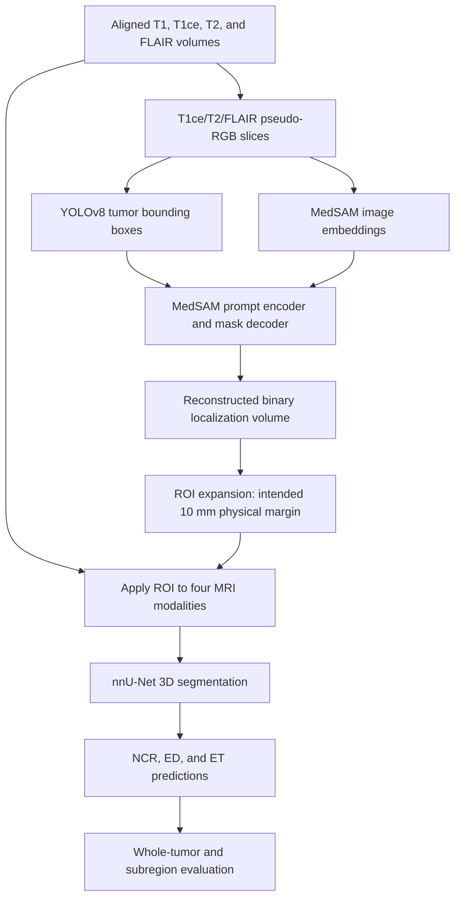

# TumorGen: Models, Loss Functions, and Segmentation Workflow

This guide explains the scientific concepts behind TumorGen and connects them to the repository. It is intended for project study, presentations, and understanding the implementation. It distinguishes **general model behavior**, **reported experimental settings**, and **current code defaults**; these are not always identical.

## Contents

1. [The segmentation problem](#1-the-segmentation-problem)
2. [MRI inputs and preprocessing](#2-mri-inputs-and-preprocessing)
3. [The complete TumorGen pipeline](#3-the-complete-tumorgen-pipeline)
4. [YOLOv8: tumor detection](#4-yolov8-tumor-detection)
5. [MedSAM: prompt-conditioned segmentation](#5-medsam-prompt-conditioned-segmentation)
6. [LoRA: parameter-efficient adaptation](#6-lora-parameter-efficient-adaptation)
7. [The 10 mm region of interest](#7-the-10-mm-region-of-interest)
8. [nnU-Net: volumetric refinement](#8-nnu-net-volumetric-refinement)
9. [Loss functions](#9-loss-functions)
10. [Training and inference](#10-training-and-inference)
11. [Evaluation and generalization](#11-evaluation-and-generalization)
12. [Implementation details and reproducibility](#12-implementation-details-and-reproducibility)
13. [Questions for project discussion](#13-questions-for-project-discussion)
14. [References](#14-references)

## 1. The segmentation problem

**Detection** identifies a location, usually as a bounding box. **Semantic segmentation** assigns a class to each pixel or voxel. A box can enclose a tumor and surrounding healthy tissue; a segmentation mask describes its spatial extent.

TumorGen separates localization from detailed segmentation. YOLO proposes tumor locations, MedSAM creates an initial binary mask, and nnU-Net predicts tumor subregions from volumetric MRI within an expanded region of interest (ROI).

The research uses BraTS cohorts, including adult glioma, Sub-Saharan African (SSA), and pediatric cases. The central question is whether the pipeline improves performance on a cohort excluded from the corresponding task-specific training combination. This is **cross-dataset generalization**, rather than proof that the model can identify any unseen tumor type.

### Tumor labels and composite regions

| Region | Meaning | Research-script label | Web encoding |
| --- | --- | ---: | ---: |
| Background | Voxels outside the annotated tumor regions | 0 | 0 |
| NCR | Necrotic/non-enhancing tumor core | 1 | 1 |
| ED | Peritumoral edema | 2 | 2 |
| ET | Enhancing tumor | 3 | 4 |

For these mappings:

- **Whole tumor (WT):** NCR ∪ ED ∪ ET.
- **Tumor core (TC):** NCR ∪ ET.
- **Enhancing tumor:** ET alone.

Dataset releases may use different label conventions. Read their specifications before converting labels. A binary localization mask merges all retained tumor labels and therefore cannot distinguish NCR, ED, and ET.

## 2. MRI inputs and preprocessing

### 2.1 Modalities

| Modality | Information used in this project | nnU-Net suffix |
| --- | --- | --- |
| T1-native | Anatomical contrast before contrast administration | `_0000.nii.gz` |
| T1ce | Contrast-enhanced appearance useful for identifying enhancement | `_0001.nii.gz` |
| T2 | Fluid-sensitive contrast and lesion context | `_0002.nii.gz` |
| FLAIR | Fluid-sensitive contrast with suppressed cerebrospinal-fluid signal | `_0003.nii.gz` |

These channels provide complementary appearance information; none is a direct tumor label. The pipeline assumes corresponding modalities occupy the same spatial grid.

### 2.2 Pseudo-RGB stacking

The 2D branch stacks spatially corresponding T1ce, T2, and FLAIR slices into a three-channel representation. The channels contain MRI measurements rather than natural photographic color. This allows a three-channel image model to receive several modalities at once.

The preprocessing scripts apply volume-wise min–max scaling:

$$
I' = 255\frac{I-I_{\min}}{I_{\max}-I_{\min}+\epsilon}.
$$

They cast the result to unsigned 8-bit images. Constant-valued volumes become zero-valued images. This is different from z-score normalization, and 8-bit conversion discards some intensity precision.

**Channel-order detail:** the scripts call `cv2.merge([t1ce, t2, flair])`, while OpenCV writes and reads color images in BGR order. The inference script then converts BGR to RGB. Consequently, the actual RGB tensor after that round trip has FLAIR first and T1ce last. The comment describing T1ce as red does not establish the tensor order. Training and inference must use the same actual channel order.

### 2.3 Geometry

A NIfTI volume consists of an array plus metadata. Its affine transforms voxel indices into physical coordinates. Equal array shapes do not guarantee matching anatomy: orientation, origin, spacing, and affine must also agree.

Use continuous interpolation for MRI intensities and nearest-neighbor interpolation for discrete class labels when resampling. Preserve slice indices during 2D processing. Missing slices must not silently cause the remaining slices to shift along the reconstructed volume.

## 3. The complete TumorGen pipeline

> We propose a two-stage coarse-to-fine segmentation framework in which MedSAM is used for initial brain tumor localization. The resulting segmentation is expanded by a 10 mm margin to define a region of interest, which is subsequently processed by nnU-Net for final tumor segmentation.

YOLO automates the bounding-box prompts for the first stage:



The benefit of this decomposition is a spatial prior: the final model receives a constrained candidate region. The cost is error propagation. If localization excludes a lesion, the refinement model has less useful input for that region.

## 4. YOLOv8: tumor detection

### 4.1 Architecture

YOLO means **You Only Look Once**. Its detection branch predicts boxes and class scores in a single network pass. YOLOv8 uses a convolutional backbone, multi-scale feature fusion, and an anchor-free detection head. C2f blocks support feature extraction; the head separates localization from classification. “Anchor-free” means it does not use a predefined library of box shapes. YOLOv8m is the medium-size variant used in the reported project. See the [official YOLOv8 overview](https://docs.ultralytics.com/models/yolov8/) and [architecture guide](https://docs.ultralytics.com/guides/yolo-architecture).

### 4.2 What a detection represents

A result contains box coordinates, a class, and a score. Here the detector targets a tumor class rather than the final tissue subregions. The box is converted into a prompt for MedSAM.

YOLO training labels use normalized coordinates:

```text
class_id center_x center_y width height
```

For an image of width $W$ and height $H$:

$$
x_c=\frac{x_1+x_2}{2W},\qquad y_c=\frac{y_1+y_2}{2H},
\qquad w=\frac{x_2-x_1}{W},\qquad h=\frac{y_2-y_1}{H}.
$$

`training/yolo_finetune/yolo_preProcessing.py` derives boxes from masks and retains the largest bounding box for each saved slice. Slices without a box are skipped. This can reduce exposure to negative examples and smaller disconnected lesions.

### 4.3 Confidence and non-maximum suppression

A confidence threshold filters weak candidates. Non-maximum suppression (NMS) removes strongly overlapping detections using intersection over union:

$$
\operatorname{IoU}(A,B)=\frac{|A\cap B|}{|A\cup B|}.
$$

A high confidence threshold can miss subtle tumors; a low one admits more false detections. Excessively aggressive NMS can suppress nearby lesions. Detector scores are not automatically calibrated probabilities of disease.

The inference function declares `conf_thresh` and `iou_thresh`, but its active YOLO call does not pass them. The commented call would pass them. The running code therefore uses the loaded Ultralytics defaults for these parameters.

### 4.4 Detector errors affect the next stage

A tight box can exclude tumor boundaries. A very large box can add ambiguity. No detection produces an empty slice mask in the current inference code. Good detection performance is therefore necessary, but does not itself establish good segmentation performance.

## 5. MedSAM: prompt-conditioned segmentation

### 5.1 SAM and medical adaptation

SAM is a promptable segmentation architecture: an image and a spatial prompt jointly determine the output mask. MedSAM adapts this foundation-model approach to medical imagery. The canonical architecture has an image encoder, prompt encoder, and mask decoder. TumorGen uses the ViT-B architecture in its inference script. See the [SAM paper](https://arxiv.org/abs/2304.02643) and [MedSAM paper](https://www.nature.com/articles/s41467-024-44824-z).

### 5.2 Image encoder

The vision transformer embeds image patches and relates their features through attention. In scaled dot-product attention:

$$
\operatorname{Attention}(Q,K,V)=\operatorname{softmax}\left(\frac{QK^T}{\sqrt{d_k}}\right)V.
$$

Queries and keys determine which features interact; values supply the information being combined. The resulting image embedding can be reused for multiple prompts on the same slice. Attention does not supply a tumor diagnosis; the learned representation and prompt determine the segmentation task.

### 5.3 Prompt encoder and mask decoder

The prompt encoder converts box coordinates into embeddings. The mask decoder combines those embeddings with image features to produce mask logits. A logit is an unbounded score; sigmoid converts a binary logit to a value between zero and one:

$$
p=\sigma(z)=\frac{1}{1+e^{-z}}.
$$

The project computes an image embedding once per slice, decodes each detected box, upsamples the probabilities to the original slice size, thresholds at 0.5, and unions the resulting masks. This gives a binary localization mask rather than a multiclass tumor-subregion map.

### 5.4 Coordinate scaling

The inference script resizes each slice to $1024\times1024$. An original coordinate maps as $x'=1024x/W$ and $y'=1024y/H$. Boxes must undergo the same transformation as the image. Independent width/height scaling also changes aspect ratio for non-square inputs; it should match the checkpoint's preprocessing assumptions.

### 5.5 Slice-wise limitations

This branch processes 2D slices independently. Stacking them into a volume does not make MedSAM a native 3D model. Discontinuities between slices, missing detections, and multiple lesions can affect the reconstructed ROI. nnU-Net supplies volumetric context later, but cannot guarantee recovery from excluded input.

## 6. LoRA: parameter-efficient adaptation

LoRA means **low-rank adaptation**. Instead of learning a full update to a pretrained linear weight $W_0$, it learns a factorized update:

$$
W=W_0+sBA,\qquad A\in\mathbb{R}^{r\times d_{in}},\qquad B\in\mathbb{R}^{d_{out}\times r}.
$$

The adapter has $r(d_{in}+d_{out})$ parameters, compared with $d_{in}d_{out}$ for a full weight update. For a $256\times256$ projection and rank 4, that is 2,048 adapter parameters versus 65,536 original parameters. This comparison applies to one projection, not the entire model. See the [original LoRA paper](https://arxiv.org/abs/2106.09685).

### 6.1 Adaptation in TumorGen

The training script selects rank-4 LoRA for the mask decoder and computes image embeddings under `torch.no_grad()`. This prevents encoder gradient updates in that training loop. The supplied adapter targets query and value projections in decoder self-attention, cross-attention, and the final token-to-image attention layer.

The base decoder transformer weights are frozen before adapters are inserted. However, other components can remain trainable and the optimizer receives `sam.parameters()`. Therefore, describe this as **decoder-side low-rank adaptation with a frozen image-encoder forward pass**, rather than asserting that every trainable parameter is a LoRA parameter.

The implementation uses the additive branch $W_0x+B(Ax)$ without an explicit LoRA scaling factor $s$. Its zero-initialized $B$ matrices initially make the adapter contribution zero. LoRA scaling, when used elsewhere, is unrelated to the Tversky-loss α parameter.

### 6.2 Why use it?

The project adapts a pretrained representation to custom multimodal pseudo-RGB MRI slices while reducing the size of selected weight updates. A small rank constrains adaptation capacity. It can reduce optimization cost, but does not guarantee improved generalization or eliminate overfitting.

The current script saves the full model state dictionary, so its checkpoint is not necessarily a small adapter-only file. Inference must instantiate a compatible architecture and load the adapted weights; the standard inference script does not explicitly construct LoRA adapters.

## 7. The 10 mm region of interest

### 7.1 Physical expansion

A physical margin depends on voxel spacing. With spacing $(s_x,s_y,s_z)$ mm, a 10 mm displacement corresponds to approximately $(10/s_x,10/s_y,10/s_z)$ voxels along the respective axes.

An exact Euclidean formulation is:

$$
M_{ROI}(v)=1\quad\text{if}\quad\min_{u:M(u)=1}\|x(v)-x(u)\|_2\leq10\ \mathrm{mm},
$$

where $x(v)$ is the physical coordinate of voxel $v$. A spacing-aware distance transform can implement this on an orthogonal grid; general affine geometry requires appropriate handling.

### 7.2 What the code currently does

`inference/masking_before_nnUnet.py` computes `ceil(10 / spacing)` but then applies six-connected binary dilation for the **maximum** of those voxel radii. This produces an approximation based on grid connectivity, not an exact 10 mm Euclidean expansion. On anisotropic data, the same iteration count can yield different physical extents in each direction.

The code then multiplies all four MRI volumes by the expanded mask:

$$
I_m^{ROI}(v)=I_m(v)M_{ROI}(v).
$$

It retains the original volume dimensions and zeros the exterior; it does not explicitly extract a smaller rectangular crop. Zeroing the exterior does not necessarily guarantee zero foreground predictions there.

### 7.3 Box padding is a separate operation

`buffer_box` expands a 2D detector box in **pixels** before MedSAM processing. It is not the 10 mm volumetric ROI margin. The standalone detector/MedSAM script defaults to 10 pixels, while `inference/test.py` passes 5 pixels. Physical 10 mm padding would require in-plane spacing and coordinate-transform handling. These existing defaults are documented here, not changed by this guide.

The ROI margin trades context against localization precision. It may preserve nearby missed boundaries, but cannot reliably rescue a lesion far from every initial detection.

## 8. nnU-Net: volumetric refinement

### 8.1 U-Net intuition

A U-Net has an encoder that builds increasingly contextual features and a decoder that restores spatial detail. Skip connections transfer high-resolution features between matching encoder and decoder stages. In a 3D model, convolutions operate across neighboring slices as well as in-plane locations. This supports volumetric shape reasoning. See the [original U-Net paper](https://arxiv.org/abs/1505.04597).

### 8.2 What makes nnU-Net different?

nnU-Net is a self-configuring segmentation framework rather than a single fixed architecture. It examines dataset properties and plans preprocessing, target spacing, patch sizes, architecture, and training configuration. Supported approaches include 2D, 3D full-resolution, and low-resolution/cascade configurations. Planning cannot make poor labels, leakage, or domain shift disappear. See the [official project](https://github.com/MIC-DKFZ/nnUNet) and [v1 documentation](https://github.com/MIC-DKFZ/nnUNet/tree/nnunetv1).

TumorGen requests `3d_fullres`. Its input contains four modality channels. Its output gives voxel-wise class scores, from which a class map can be obtained using argmax.

### 8.3 Patch inference and model combinations

When a volume exceeds the inference patch size, overlapping sliding windows cover it. Their predictions are combined to reduce patch-boundary artifacts. Fold ensembling combines predictions from independently trained cross-validation folds. Test-time augmentation combines transformed versions of an input. These are different mechanisms.

TumorGen's inference wrapper passes `-f all` and disables test-time augmentation with `--disable_tta`. In nnU-Net v1, the literal `all` refers to the `fold_all` model trained on all available training data; it does not mean an ensemble of numbered cross-validation folds. Numbered-fold ensembling requires the appropriate fold selection and checkpoints. A fold argument does not train missing models.

### 8.4 Version terminology

The repository invokes `nnUNet_plan_and_preprocess`, `nnUNet_train`, and `nnUNet_predict`, which are **nnU-Net v1** commands. `nnUNetTrainerV2` is a trainer name within v1, not evidence that the project uses the separate nnU-Net v2 framework. The prediction docstring currently calls the wrapper v2, but the command determines the actual interface.

## 9. Loss functions

A loss is a differentiable training objective. A metric reports evaluation performance. Related equations can serve both purposes, but training usually uses probabilities and evaluation usually uses discrete masks.

### 9.1 Notation and activations

Let $y_i\in\{0,1\}$ be the reference label and $p_i\in[0,1]$ the predicted foreground probability for location $i$. For mutually exclusive classes, softmax normalizes logits across classes:

$$
p_{ic}=\frac{e^{z_{ic}}}{\sum_k e^{z_{ik}}}.
$$

Sigmoid is appropriate for binary outputs or independently modeled labels. Softmax is appropriate for mutually exclusive class outputs. Activation, target encoding, and loss implementation must agree. Do not apply sigmoid twice when a loss already applies it internally.

### 9.2 Cross-entropy

For $C$ classes with one-hot targets:

$$
\mathcal{L}_{CE}=-\frac1N\sum_{i=1}^{N}\sum_{c=1}^{C}y_{ic}\log p_{ic}.
$$

For binary classification:

$$
\mathcal{L}_{BCE}=-\frac1N\sum_i\left[y_i\log p_i+(1-y_i)\log(1-p_i)\right].
$$

Cross-entropy penalizes assigning low probability to the true class. For a true foreground example, predicting 0.9 contributes about 0.105, while predicting 0.1 contributes about 2.303. In dense segmentation, a large background class can dominate an unweighted average. Class weights or overlap-based objectives can address this imbalance.

The reported project configuration names cross-entropy for classification. This does not mean that a separate patient-level tumor-type classifier exists. The committed MedSAM loop does not add a cross-entropy term.

### 9.3 Dice loss

A common soft Dice coefficient and loss are:

$$
D=\frac{2\sum_i p_i y_i+\epsilon}{\sum_i p_i+\sum_i y_i+\epsilon},\qquad
\mathcal{L}_{Dice}=1-D.
$$

Dice rewards foreground overlap and is less directly dominated by background counts. Its value depends on whether classes, samples, or the whole batch are aggregated. Empty targets require an explicit convention.

The standard v1 nnU-Net trainer uses a Dice/cross-entropy objective, with deep supervision in `nnUNetTrainerV2`. That default is distinct from TumorGen's reported Tversky configuration; the repository wrapper does not install a custom nnU-Net Tversky trainer. See the [v1 trainer source](https://github.com/MIC-DKFZ/nnUNet/blob/nnunetv1/nnunet/training/network_training/nnUNetTrainerV2.py).

### 9.4 Tversky loss

Define soft counts:

$$
TP=\sum_i p_i y_i,\quad FP=\sum_i p_i(1-y_i),\quad FN=\sum_i(1-p_i)y_i.
$$

Using the convention **α weights false positives and β weights false negatives**:

$$
TI=\frac{TP+\epsilon}{TP+\alpha FP+\beta FN+\epsilon},\qquad
\mathcal{L}_{Tversky}=1-TI.
$$

At α = β = 0.5, the unsmoothed expression reduces to Dice. Asymmetric weights change which errors contribute more to the denominator. Check the convention used by each paper or library; parameter names alone do not establish the interpretation. See the [Tversky-loss paper](https://arxiv.org/abs/1706.05721) and [MONAI implementation](https://github.com/Project-MONAI/MONAI/blob/dev/monai/losses/tversky.py).

The **reported project setting** is **α = 0.7, β = 0.3**. Under this convention, false positives receive the larger penalty. It should not be described as automatically prioritizing recall or reducing missed tumors.

The **committed MedSAM training setting** is `TverskyLoss(sigmoid=True, alpha=0.3, beta=0.7)`, which gives false negatives the larger penalty. These settings reverse the error preference.

For illustration, let TP = 80, FP = 20, FN = 10 and ignore smoothing:

| Setting | Tversky index | Loss |
| --- | ---: | ---: |
| α = 0.7, β = 0.3 | 80 / 97 ≈ 0.825 | 0.175 |
| α = 0.3, β = 0.7 | 80 / 93 ≈ 0.860 | 0.140 |

The first setting penalizes this prediction more because it contains more false positives than false negatives. Changing weights alone does not guarantee the desired behavior after training.

### 9.5 Combining losses and deep supervision

A possible combined objective is:

$$
\mathcal{L}=\lambda_{CE}\mathcal{L}_{CE}+\lambda_{T}\mathcal{L}_{Tversky}.
$$

This is a general formulation, not evidence that this exact sum or particular weights were used in the experiments. Loss coefficients, stage assignment, and reduction rules must be recorded.

Deep supervision applies losses to several decoder resolutions:

$$
\mathcal{L}_{DS}=\sum_s w_s\mathcal{L}_s.
$$

It encourages intermediate predictions to learn useful segmentation structure. Resize discrete class targets appropriately when supervising lower-resolution outputs.

### 9.6 YOLO detection loss

YOLOv8 detection uses classification, bounding-box regression, and distribution focal loss (DFL) components. Its classification term uses binary cross-entropy on assigned class targets. Box regression uses an IoU-based objective; DFL supervises distributions over discretized box offsets. DFL is not the same as focal Tversky loss. Exact coefficients depend on the installed Ultralytics version and training configuration. See the [official loss source](https://docs.ultralytics.com/reference/utils/loss/).

## 10. Training and inference

Training computes predictions, evaluates a loss, backpropagates gradients, and updates parameters. Inference applies fixed learned parameters to new inputs without gradient updates.

The MedSAM script defaults to 50 epochs, batch size 2, learning rate $10^{-4}$, AdamW, and weight decay 0.1. AdamW maintains adaptive update statistics and applies decoupled weight decay. Optional warmup gradually increases the learning rate before the loop's later schedule. A `StepLR` object is created, but no scheduler step is called in the file.

Validation runs every other epoch and saves the best model according to the script's DSC calculation. These are source defaults, not a complete historical experiment record. The validity of the metric depends on output-channel semantics, target shape, and the local helper implementation.

For study and reproduction, record checkpoints, model versions, patient split lists, actual input channels, transforms, losses, optimizer settings, random seeds, and ROI behavior. Checkpoint names and a plotted training curve alone do not establish the full configuration.

## 11. Evaluation and generalization

### 11.1 Metrics

For discrete masks:

$$
DSC=\frac{2TP}{2TP+FP+FN},\quad IoU=\frac{TP}{TP+FP+FN},
$$

$$
Precision=\frac{TP}{TP+FP},\qquad Recall=\frac{TP}{TP+FN}.
$$

Precision measures how much predicted foreground is correct; recall measures how much reference foreground is recovered. Neither alone describes full segmentation quality. Boundary metrics such as HD95 can reveal errors that overlap scores hide, but the committed evaluator does not compute HD95.

Case-wise averaging gives each patient equal weight; pooling voxel counts gives larger lesions more influence. Report which aggregation was used, sample counts, dispersion, and empty-region conventions. In `evaluation.py`, two empty masks return Dice 0 because only the denominator is smoothed; the website uses Dice 1 for both-empty regions. Those conventions are not interchangeable.

### 11.2 Why WT can improve while subregions worsen

A voxel incorrectly labeled ET instead of ED remains inside WT. Whole-tumor overlap can therefore be good even when subregion classification is poor. Localization constrains spatial extent, while discriminating tissue regions remains dependent on appearance and annotation conventions.

The site's reported comparisons include:

| Evaluation cohort | Training cohorts | nnU-Net baseline WT DSC | TumorGen WT DSC |
| --- | --- | ---: | ---: |
| SSA | Adult glioma + Pediatric | 0.70 | 0.76 |
| Pediatric | Adult glioma + SSA | 0.12 | 0.64 |
| Adult glioma | Adult glioma + SSA | 0.92 | 0.88 |
| Adult glioma | Adult glioma + Pediatric | 0.92 | 0.87 |

These are transcribed experimental results in `web/src/research.ts`, not metrics recomputed for this document. The held-out-cohort improvements support the project's research observation; the adult-glioma comparisons also show a performance trade-off. They do not establish uniform improvement across NCR, ED, and ET or statistical significance.

### 11.3 Domain shift and leakage

Domain shift can involve scanners, acquisition protocols, lesion morphology, patient age, or annotation practice. An evaluation cohort absent from task-specific training is not necessarily absent from all upstream foundation-model pretraining.

Split at the **patient level**, not the slice level. Adjacent slices from the same patient are strongly related. The current YOLO preparation function shuffles image-label triplets and splits them, so the same patient can appear in multiple partitions. This can inflate apparent generalization. A scientific reproduction should use verified patient-disjoint lists and freeze the held-out cohort before model selection.

The live visualization uses separate public UPenn-GBM cases and published automated masks. Its agreement metrics are not the BraTS experiment results and do not demonstrate inference with integrated TumorGen weights.

## 12. Implementation details and reproducibility

| File | Role and important detail |
| --- | --- |
| [rgb_stacking.py](inference/rgb_stacking.py) | Min–max normalization and slice export; verify channel order and geometry. |
| [yolo_preProcessing.py](training/yolo_finetune/yolo_preProcessing.py) | Box extraction, largest-box selection, and image-level splitting. |
| [seg_file_using_medsam_yolo.py](inference/seg_file_using_medsam_yolo.py) | YOLO prompts, MedSAM masks, union, and NIfTI reconstruction. |
| [lora_fine_tune.py](training/medsam_finetune/lora_fine_tune.py) | Decoder LoRA, Tversky defaults, optimizer, and validation. |
| [LoRA_Sam.py](training/medsam_finetune/models/LoRA_Sam.py) | Low-rank query/value projection updates. |
| [masking_before_nnUnet.py](inference/masking_before_nnUnet.py) | Approximate 10 mm ROI dilation and four-modality masking. |
| [train.py](training/nnUnet/train.py) | v1 nnU-Net planning and training commands. |
| [nnunet_inference.py](inference/nnunet_inference.py) | v1 prediction with TTA disabled; `device` is not forwarded to the CLI. |
| [evaluation.py](evaluation/evaluation.py) | Per-label Dice/counts for `BraTS-SSA*` directories. |

Additional details matter when reproducing the pipeline:

- The LoRA training script imports `models.sam_LoRa`, whereas the supplied adapter file is `models/LoRA_Sam.py`; local dataset and utility helpers are also required. Resolve this integration before training.
- Training passes no box prompts, while the standard inference path uses YOLO boxes. Treat this as a training/inference conditioning difference requiring validation.
- Standard inference loads a SAM-registry checkpoint and does not explicitly recreate the adapted LoRA structure. Confirm compatibility instead of assuming an adapted state dictionary can be loaded directly.
- Reconstruction uses a reference segmentation's affine when available and otherwise an identity affine. Production inference should obtain geometry from the MRI reference; identity geometry can invalidate spatial interpretation.
- Failed or skipped slices can shorten reconstructed volumes. Preserve original indices and dimensions rather than simply stacking successful slices.
- The evaluator attempts a transpose after a shape mismatch. This is not a substitute for physical registration or affine verification. Its reported FP percentage is FP divided by reference foreground count, not the conventional false-positive rate FP/(FP+TN).
- Inference paths and helper dependencies require local configuration. This document explains the current scripts; it does not claim that the full pipeline runs without that integration.

## 13. Questions for project discussion

**Why combine three models?** YOLO automates localization prompts, MedSAM estimates a binary candidate region, and nnU-Net performs volumetric subregion segmentation. Each has a distinct role, with additional runtime and error propagation as trade-offs.

**Is MedSAM the final tumor classifier?** In this pipeline it produces the initial binary localization mask. nnU-Net supplies the final multiclass map.

**Why a 10 mm margin?** It retains surrounding context and tolerates modest localization errors. Its value is a project choice that should be assessed through margin ablations; it is not a universal optimum.

**Why LoRA instead of full fine-tuning?** It limits selected parameter updates while adapting the decoder to the custom MRI representation. The actual trainable parameter count must be measured for this implementation.

**Does better WT Dice prove better tumor-region classification?** No. WT merges subregions, so tissue-label substitutions can leave WT unchanged.

**Which ablations would clarify the contribution?** Compare nnU-Net alone, YOLO-derived ROI, MedSAM-derived ROI, several physical margins, and adaptation with/without LoRA using identical patient splits and training budgets. These are proposed comparisons, not completed experiments claimed by this guide.

## 14. References

- [Ultralytics YOLOv8 documentation](https://docs.ultralytics.com/models/yolov8/)
- [Ultralytics architecture guide](https://docs.ultralytics.com/guides/yolo-architecture)
- [Ultralytics detection loss implementation](https://docs.ultralytics.com/reference/utils/loss/)
- [Kirillov et al., Segment Anything](https://arxiv.org/abs/2304.02643)
- [Ma et al., Segment Anything in Medical Images](https://www.nature.com/articles/s41467-024-44824-z)
- [Official MedSAM repository](https://github.com/bowang-lab/MedSAM)
- [Hu et al., LoRA](https://arxiv.org/abs/2106.09685)
- [Ronneberger et al., U-Net](https://arxiv.org/abs/1505.04597)
- [Official nnU-Net repository and v1 branch](https://github.com/MIC-DKFZ/nnUNet/tree/nnunetv1)
- [nnU-Net v1 trainer source](https://github.com/MIC-DKFZ/nnUNet/blob/nnunetv1/nnunet/training/network_training/nnUNetTrainerV2.py)
- [Salehi et al., Tversky Loss](https://arxiv.org/abs/1706.05721)
- [MONAI Tversky loss source](https://github.com/Project-MONAI/MONAI/blob/dev/monai/losses/tversky.py)
- [TumorGen research workflow and results](https://crimson-disk-92b1.sahniwesh.workers.dev/?view=research)

External references describe the underlying methods. Statements about this repository are based on the linked implementation files; reported project results are taken from the website's research data.
